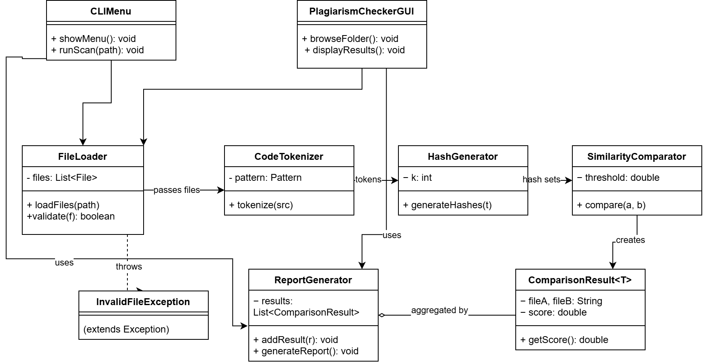

## System Design

The Code Plagiarism Checker is built as a pipeline. Each class does one job and produces an output that is passed to the next stage. The two entry points, `CLI_Menu` (console) and `GUI` (graphical window), act as coordinators: they create the pipeline classes, call them in order, and pass each stage's output to the next. The pipeline classes do not call each other, so any stage can be changed without touching the others.

### Architecture

```
CLI_Menu / GUI
      |  path and threshold
      v
FileInputService  --records-->  errors / skippedFiles lists
      |  List<SourceFile>
      v
CodeTokenizer
      |  List<String> tokens
      v
HashGenerator
      |  Set<Long> fingerprints (k = 5, SHA-256)
      v
SimilarityComparator
      |  ComparisonResult<Double> per pair
      v
ReportGenerator (console)   /   GUI results area and text export
```

### UML class diagram



*(Save the UML image as `docs/UML_Class.png` in the repository.)*

### Classes

| Class | Responsibility | Attributes | Methods |
|---|---|---|---|
| CLI_Menu | Console entry point: reads the path and threshold, compares every pair of files and starts the report | none | `main(args): void` |
| GUI (extends JFrame) | Graphical entry point: select a folder, choose two files, set the threshold, compare, export and clear | `fileManager: FileInputService`, `tokenizer: CodeTokenizer`, `hashGenerator: HashGenerator`, `similarityService: SimilarityComparator`, `selectedFolder: Path` (plus Swing components) | `GUI()`, `initializeGUI()`, `selectFolder()`, `compareFiles()`, `exportReport()`, `clearResults()`, `main(args)` |
| FileInputService | Finds and reads Java files in a file or folder, skips invalid ones and records problems | `errors: List<String>`, `skippedFiles: List<String>` | `readInput(path): List<SourceFile>`, `scanDirectory(root)`, `isValidJavaFile(path)`, `readJavaFile(path)`, `getErrors()`, `getSkippedFiles()` |
| SourceFile | Holds one source file: path, name, content, size | `path: Path`, `fileName: String`, `content: String`, `size: long` | `getPath()`, `getFileName()`, `getContent()`, `getSize()` |
| CodeTokenizer | Breaks source code into tokens, ignoring whitespace and comments | `OPS: String[]`, `SYMBOLS: String` | `tokenize(s): List<String>` |
| HashGenerator | Turns a token list into a set of k-gram hashes | `k: int` | `generateHashes(tokens): Set<Long>`, `hash(text): long` |
| SimilarityComparator | Compares two hash sets, calculates the similarity and decides whether a pair is flagged | `threshold: double` | `compare(a, ha, b, hb): ComparisonResult<Double>`, `calculateSimilarity(a, b)`, `isFlagged(r)`, `getThreshold()`, `setThreshold(t)`, `getSharedFingerprints(a, b)` |
| ComparisonResult&lt;T extends Number&gt; | Stores the result for one pair of files | `fileA, fileB: String`, `score: T` | `getFileA()`, `getFileB()`, `getScore(): T` |
| ReportGenerator | Prints the report for all results | none | `generateReport(results, comparator): void` |

### Relationships

| From | Relationship | To | Multiplicity |
|---|---|---|---|
| CLI_Menu, GUI | uses | FileInputService, CodeTokenizer, HashGenerator, SimilarityComparator | 1 to 1 |
| CLI_Menu | uses | ReportGenerator | 1 to 1 |
| CLI_Menu, GUI | uses | SourceFile, ComparisonResult | 1 to 0..* |
| FileInputService | creates | SourceFile | 1 to 0..* |
| SimilarityComparator | creates | ComparisonResult | 1 to 0..* |
| ReportGenerator | uses | ComparisonResult | 1 to 0..* |
| ReportGenerator | uses | SimilarityComparator | 1 to 1 |

### How the similarity score works

`SimilarityComparator` divides the number of fingerprints two files share by the number of distinct fingerprints in both files (the Jaccard index). A pair is flagged for review when its score is at or above the threshold (75% by default). A flag is not proof of plagiarism; a person must review the code.

### Design decisions

- **Pipeline with coordinators:** `CLI_Menu` and `GUI` only collect input and show output, so the checking logic is not duplicated.
- **Tokens before hashes:** spacing, line breaks and comments do not hide copied code.
- **k-gram hashes:** hashing k consecutive tokens keeps the order of the code and makes comparison fast.
- **Threshold inside `SimilarityComparator`:** the cut-off is kept in one place and can be changed with `setThreshold`.
- **Generic `ComparisonResult<T extends Number>`:** the score type is not fixed, but must be a number.
- **Error lists:** `FileInputService` records skipped files and errors, so one bad file never stops a scan.

### Limits

- Variable names are kept as written, so renaming variables lowers the score.
- The console version compares every pair of files; the GUI compares the two files the user selects.
- The console report lists pairs in the order they were compared, not sorted by score.

### Complexity

For `n` files of average length `L`, every pair is compared, so there are n(n-1)/2 comparisons and the running time grows as O(n² · L).
